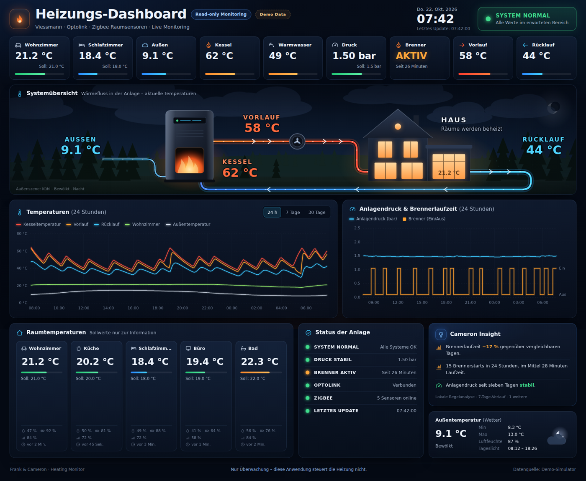

# Frank & Cameron – Heating Monitor

Premium **read-only** monitoring dashboard for a Viessmann heating system with Optolink
boiler data, Zigbee room sensors, weather and local analysis ("Cameron Insight").

> # THIS SOFTWARE CURRENTLY MONITORS ONLY.
> # IT DOES NOT CONTROL THE HEATING SYSTEM.



Design reference: [`docs/design-reference.png`](docs/design-reference.png) · Mobile: [`docs/screenshot-phone.png`](docs/screenshot-phone.png)

## Current state (v0.1.0)

- Runs entirely on **realistic, deterministic demo data** (`DATA_MODE = "demo"`).
- Production architecture is already in place: source → normalization → provider → dashboard → analysis.
- Next phase: Raspberry Pi API with real Optolink and Zigbee data — **without rewriting the UI**.

## Run locally

No build step, no dependencies. Any static HTTP server works (ES modules need `http://`, not `file://`):

```bash
python3 -m http.server 8080
# open http://localhost:8080
```

Alternatives: `npx serve .`, `php -S localhost:8080`, nginx/caddy on the Pi.

## Demo data

The simulator (`js/data/simulator.js`) is a small physical model: outdoor weather with daily
and multi-day cycles, burner hysteresis around a heating curve, boiler/supply/return
temperatures, hot-water tank, five rooms with radiator valves, night setback, sunrise/sunset.

- Deterministic: same time → same values; reload does not reshuffle.
- History and current state come from one continuous run → always consistent.
- Pressure stays around 1.45–1.55 bar and follows water temperature.
- A subtle **DEMO DATA** badge is shown (`SHOW_DEMO_BADGE` in `js/config.js`).

Preview states (demo only):

| URL | Shows |
|---|---|
| `?scenario=stale` | data 17 minutes old |
| `?scenario=optolink-offline` | boiler data unavailable |
| `?scenario=sensor-offline` | one Zigbee sensor offline |
| `?scenario=zigbee-offline` | whole Zigbee network offline |
| `?scenario=low-battery` | sensor battery warning |
| `?scenario=pressure-low` / `pressure-critical` | pressure loss warning / critical |
| `?scenario=overheat` | boiler temperature critical |
| `?scenario=missing` | partially missing fields |
| `?scenario=offline` | data source unreachable |
| `?delay=2500` | loading state |
| `?outside=-4&weather=snow` | outdoor scene preview (`clear`, `partly-cloudy`, `cloudy`, `fog`, `rain`, `snow`) |
| `?mode=json` | static files in `data/` |
| `?lowpower=1` | no animations (Pi kiosk) |

Regenerate the static demo files: `node tools/generate-demo-data.mjs`.

## Architecture

```
SENSORS / DATA SOURCE   demo simulator · static JSON · Raspberry Pi API
        ↓
NORMALIZATION           js/core/normalize.js  (+ Optolink/Zigbee/weather adapters on the Pi)
        ↓
DATA PROVIDER           js/data/data-provider.js  ← the only interface the UI uses
        ↓
DASHBOARD               js/ui/*
        ↓
ANALYSIS                js/analysis/*  (status, Cameron Insight, sanitized snapshot)
```

Details: [`docs/ARCHITECTURE.md`](docs/ARCHITECTURE.md) · data contract: [`docs/DATA_FORMAT.md`](docs/DATA_FORMAT.md)

## Directory structure

```
index.html                 dashboard markup (CSP, no inline scripts)
css/app.css                complete styling, responsive, reduced motion
js/app.js                  bootstrap, polling, wiring
js/config.js               all settings (no secrets)
js/core/                   time, formatting, normalization, periods
js/data/                   provider facade, simulator
js/data/providers/         demo · json · api (Pi) · weather · read-only HTTP client
js/data/adapters/          optolink · zigbee · weather · compose-state
js/analysis/               status · insights · analysis snapshot · stats
js/ui/                     dashboard, cards, flow diagram, scenes, charts, panels, icons
data/                      generated demo data + sanitized analysis snapshot
assets/                    favicon, scene image slots (weather/), heating/, icons/
docs/                      architecture, data format, Pi, Optolink, Zigbee, AI, security
tools/                     demo-data generator, read-only guard
BOT_RULES.md               rules for automated agents
```

## Publish the static frontend

Copy the repository folder to any static web server. On the Raspberry Pi, serve it from the
same origin as the API (`/api/*`) so the Content-Security-Policy works unchanged.
GitHub Pages also works for the demo, but the core app does not depend on GitHub.
Keep the repository **private**; never publish real telemetry.

## Future integration

| Topic | Where | Doc |
|---|---|---|
| Raspberry Pi API | `js/data/providers/api-provider.js` (`DATA_MODE: 'api'`) | [`PI_INTEGRATION.md`](docs/PI_INTEGRATION.md) |
| Optolink | `normalizeOptolinkReading()` in `js/data/adapters/optolink-adapter.js` | [`OPTOLINK.md`](docs/OPTOLINK.md) |
| Zigbee | `normalizeZigbeeSensor()` in `js/data/adapters/zigbee-adapter.js` | [`ZIGBEE.md`](docs/ZIGBEE.md) |
| Weather | `js/data/providers/weather-provider.js` + `weather-adapter.js` | [`ARCHITECTURE.md`](docs/ARCHITECTURE.md) |
| AI / Grok agent | `GET /api/insights` → `combineInsights()`; input `buildAnalysisSnapshot()` | [`AI_ANALYSIS.md`](docs/AI_ANALYSIS.md) |

Exact Optolink datapoints will be added after reading the real installation.

## Cameron Insight

Version 1 uses deterministic local rules only — no external AI is called:
burner runtime vs comparable days, living-room heat-up time, pressure stability and trend,
return temperature, burner cycling, sensor health, hot water, data quality.
Interface: `generateInsights(currentState, history, options)` → structured insights.
An AI agent can later supply insights in the same shape.

## Security model

Read-only by design and by enforcement: GET-only client with endpoint allowlist, no control
UI, strict CSP, no secrets in the repository, `node tools/check-readonly.mjs` as guard
(optional CI workflow included). See [`docs/SECURITY.md`](docs/SECURITY.md) and [`BOT_RULES.md`](BOT_RULES.md).

## Configuration highlights (`js/config.js`)

`DATA_MODE`, `API_BASE_URL`, `POLLING` (30 s current / 5 min history), `FRESHNESS`,
`THRESHOLDS` (assumed limits — verify for your installation), `ROOMS`, `HEADLINE_ROOMS`,
`CHART_ROOM`, `DECIMAL_SEPARATOR` (`.` or `,`), `LOW_POWER`, `SHOW_DEMO_BADGE`.

---

Frank & Cameron · IDEAS × CODE × IMPACT
